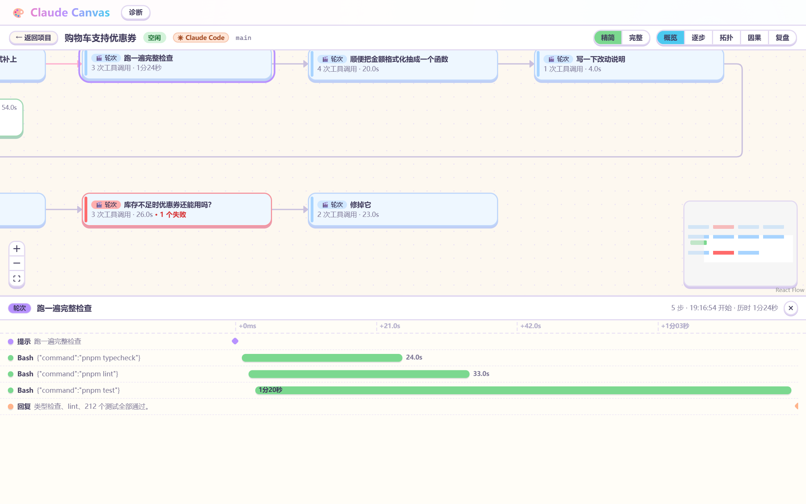
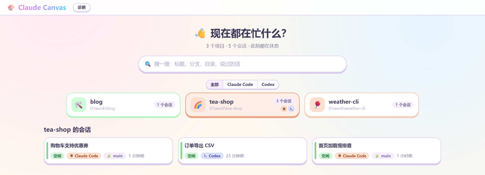
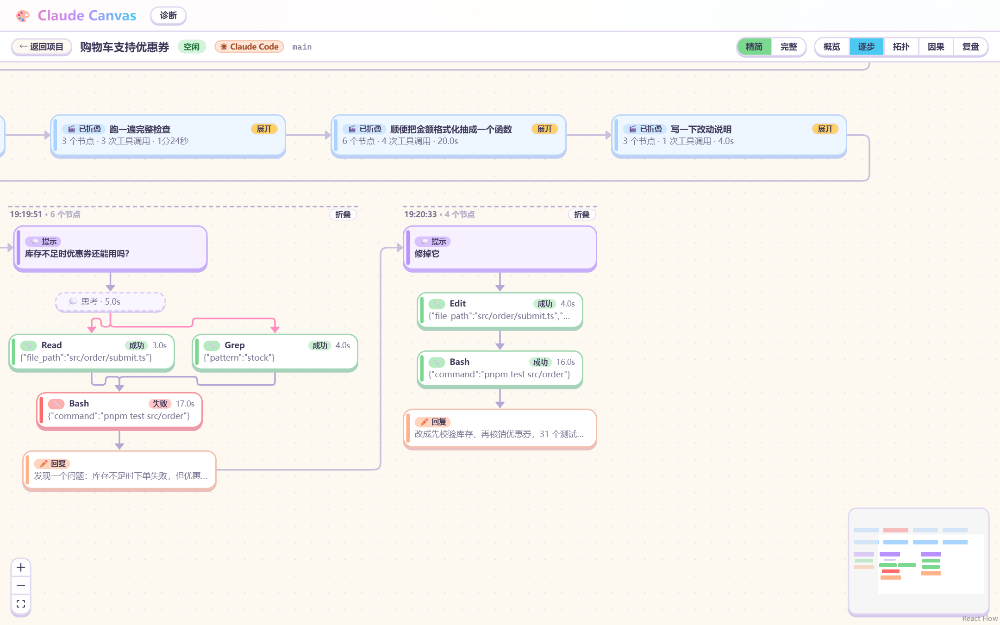
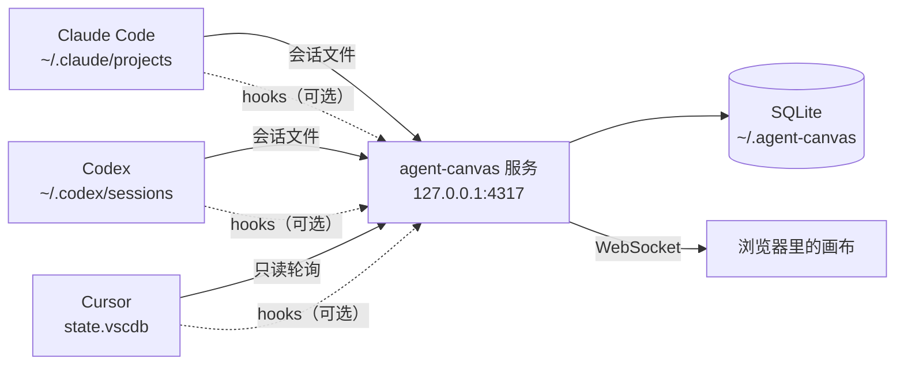

<h1 align="center">🎨 Agent Canvas</h1>

<p align="center">
  <b>把编码智能体正在做的事，画成一张看得懂的画布。</b>
</p>

<p align="center">
  Agent Canvas 是一个跑在你本机的小服务。<br/>
  它读取 Claude Code、OpenAI Codex 和 Cursor 的会话记录，在浏览器里实时画出每个会话的来龙去脉：<br/>
  问了什么、调了哪些工具、派了哪些子代理、哪一步慢、哪一步失败。
</p>

<p align="center">
  <a href="https://www.npmjs.com/package/@qtxsnwwb/agent-canvas"></a>
  <a href="./LICENSE"></a>
  
  
  
  
  
  
</p>

<p align="center">
  <a href="#-快速开始">快速开始</a> ·
  <a href="#-五个视角">五个视角</a> ·
  <a href="#-支持情况">支持情况</a> ·
  <a href="./docs/manual.md">使用手册</a>
</p>

<p align="center">
  
</p>
<p align="center">
  <em>概览：每个轮次一张卡片，排成网格；点开一个轮次，下方的瀑布图列出它的每一步和耗时</em>
</p>

## ✨ 为什么用它

### 👀 一眼看清会话在干什么
终端里的输出滚过去就没了。画布把一个会话拆成轮次，每个轮次一张卡片：用了几次工具、花了多久、有没有失败，不用翻记录。

### ⏱️ 知道时间花在哪
选中任意一个轮次或子代理，瀑布图按时间轴列出每一步。并行的调用并排显示，慢的那一步一眼就能看出来。

### 🤖 子代理不再是黑盒
主线派出的子代理挂在对应的轮次下面，可以展开看它内部的每一步；后台运行的子代理会一直跟到它真正结束。

### 🧩 三种工具，一个页面
Claude Code、Codex 和 Cursor 的会话放在一起。同一个工作目录下的会话归到同一个项目，每个会话带来源标记，首页可以按来源筛选。

### ⚡ 接近实时
只靠会话文件就能工作，延迟几秒。装上 hooks 之后状态变化在 1 秒内到达，还能看到“正在等你确认权限”。

### 🔒 数据不出本机
只监听 `127.0.0.1`，不联网、不上传。对会话文件只读，数据存在本地的 SQLite 里。

## 📸 界面一览

<p align="center">
  
</p>
<p align="center">
  <em>首页：按项目列出会话，可检索、可按来源筛选</em>
</p>

<p align="center">
  
</p>
<p align="center">
  <em>逐步视角：提示、思考、工具调用、回复一个个画出来，并行的调用左右排开</em>
</p>

> 截图里的项目和对话都是虚构的演示数据。

## 🚀 快速开始

需要 **Node ≥ 22**。一条命令，不用克隆、不用构建：

```bash
npx @qtxsnwwb/agent-canvas
```

终端打印出地址后，在浏览器打开：

```
agent-canvas listening on http://127.0.0.1:4317
```

就这些。第一次启动会在后台导入已有的会话，历史多的话要等一会儿，期间页面已经可以用。

<details>
<summary><b>长期使用：全局安装</b></summary>

```bash
npm install -g @qtxsnwwb/agent-canvas
agent-canvas                 # 启动
agent-canvas --port 4400     # 换端口
agent-canvas --version
```

按 `Ctrl+C` 停止。同一个数据目录同时只能运行一个服务。想装 Codex 或 Cursor 的 hooks 的话，需要用这种方式安装（见下）。

</details>

### 🔌 可选：装上 hooks，状态更实时

不装也能用。装了之后状态变化更快，并且能显示“等待权限确认”。

```bash
# Claude Code
agent-canvas hooks install

# Codex（装完需要在 Codex 的 设置 → Hooks 里确认信任）
agent-canvas hooks install --codex

# Cursor（保存后自动生效）
agent-canvas hooks install --cursor
```

没有全局安装时，把 `agent-canvas` 换成 `npx @qtxsnwwb/agent-canvas`。Codex 和 Cursor 的 hooks 里要写入程序的绝对路径，而 `npx` 的缓存位置不固定，所以这两种 hooks 只能在全局安装之后装；Claude Code 的不受影响。

安装前会先列出要改的文件和内容并询问确认，改之前自动备份；`hooks uninstall`（加 `--codex` / `--cursor` 对应另外两个工具）可以原样移除。Cursor 的 hooks 只装观察类事件，不会拦住 Cursor 的任何操作，所以 Cursor 会话没有“等待权限确认”。细节见[使用手册 · Hooks](./docs/manual.md#hooks可选)。

## 🖼️ 五个视角

| 视角 | 看什么 | 适合 |
|------|--------|------|
| **概览**（默认） | 每个轮次一张卡片，下面挂它派出的子代理；选中后下方出瀑布图 | 快速了解一个会话做了什么 |
| **逐步** | 提示、思考、工具、回复全部画出来 | 看某一轮的具体过程 |
| **拓扑** | 隐藏思考和回复，只留提示、工具调用和子代理 | 看主线和子代理的分工 |
| **因果** | 选中一个节点，高亮它上游的一整条链 | 追问“这一步是怎么来的” |
| **复盘** | 拖动时间轴重放整个会话，带耗时和 token | 事后回顾、找瓶颈 |

画布按网格排版：轮次从左到右排，排满换行；一轮里步骤太多时折成并排的几列。会话再长，也不会变成一条拉不到头的竖线。

## 🧩 支持情况

| 能力 | Claude Code | Codex | Cursor |
|------|:-----------:|:-----:|:------:|
| 数据来源 | 会话文件 | 会话文件 | 本地数据库（只读） |
| 轮次、工具调用、回复 | ✅ | ✅ | ✅ |
| 并行调用的分叉与汇合 | ✅ | ✅ | ✅ |
| 子代理（含嵌套） | ✅ | ✅ | ✅ |
| 每一步的耗时与成败 | ✅ | ✅ | ✅ |
| 思考内容 | ⚠️ 多数只有时长 | ⚠️ 只有摘要，多数为空 | ⚠️ 只有 Cursor 存下来的部分 |
| token 用量 | ✅ | ❌ | ❌ |
| hooks：实时状态 | ✅ | ⚠️ 已实现，未用真实数据验证 | ⚠️ 已实现，未用真实数据验证 |
| hooks：等待权限确认 | ✅ | ⚠️ 同上 | ❌ 不做（见手册） |
| 已归档的会话 | — | ❌ 不导入 | ❌ 不导入 |

| 平台 | 状态 |
|------|------|
| Windows | ✅ 经过测试 |
| macOS / Linux | ⚠️ 应当可用，未系统测试 |

## 🏗️ 它是怎么工作的



服务监视 Claude Code 和 Codex 的会话文件，每隔几秒只读地查一次 Cursor 的本地数据库，把三种来源的记录归一成同一种图（节点和边），存进本地数据库，再通过 WebSocket 推给页面。原始记录也一并保存，升级后可以据此重新推导，不需要重新导入。

## ⚙️ 配置

都是可选的环境变量：

| 变量 | 默认值 | 含义 |
|------|--------|------|
| `AGENT_CANVAS_PROJECTS_DIR` | `~/.claude/projects` | Claude Code 会话文件的目录 |
| `AGENT_CANVAS_CODEX_DIR` | `~/.codex/sessions` | Codex 会话文件的目录；设为空字符串表示不读取 |
| `AGENT_CANVAS_CURSOR_DB` | Cursor 的 `state.vscdb`（按平台，见手册） | Cursor 的本地数据库，只读打开；设为空字符串表示不读取 |
| `AGENT_CANVAS_DATA_DIR` | `~/.agent-canvas` | 数据目录（数据库 `data.db`） |

完整列表见[使用手册 · 数据与环境变量](./docs/manual.md#数据与环境变量)。

## 🔒 安全与隐私

- 只监听 `127.0.0.1`，不对局域网开放；来自非本机页面的请求会被拒绝。
- 没有账号、没有遥测、不联网。
- 对会话文件只读；Cursor 的数据库只读打开，只做按主键的短查询，从不写入。只有你主动运行 `hooks install` 时，才会修改 Claude Code、Codex 或 Cursor 的配置文件，并且先备份。
- 数据库里是你的对话和工具输出的明文，请像对待对话记录本身一样对待数据目录。

## 📚 文档

- [使用手册](./docs/manual.md)：首页检索、各视角的细节、hooks、诊断页、重建、已知限制
- [诊断页](./docs/manual.md#诊断页)：页面右上角的“诊断”，看导入进度、hook 是否收到、未识别的记录
- [已知限制](./docs/manual.md#已知限制)

## 🛠️ 开发

```bash
git clone https://github.com/qtxsnwwb/agent-canvas.git
cd agent-canvas
pnpm install                            # 没装 pnpm 时用 npx --yes pnpm@10 代替 pnpm
pnpm build
pnpm start                              # 从源码启动

pnpm test                               # 单元测试（vitest）
pnpm typecheck
pnpm --filter @agent-canvas/web dev    # 网页开发服务器，需先启动服务
pnpm release                            # 在 release/ 里生成要发布到 npm 的包
```

项目是一个 pnpm workspace：`packages/server`（Fastify + better-sqlite3）、`packages/web`（React + React Flow）、`packages/shared`（共用的图模型）。发布到 npm 的是把三者合成的一个包 `@qtxsnwwb/agent-canvas`。

## 📄 许可证

[MIT](./LICENSE)
