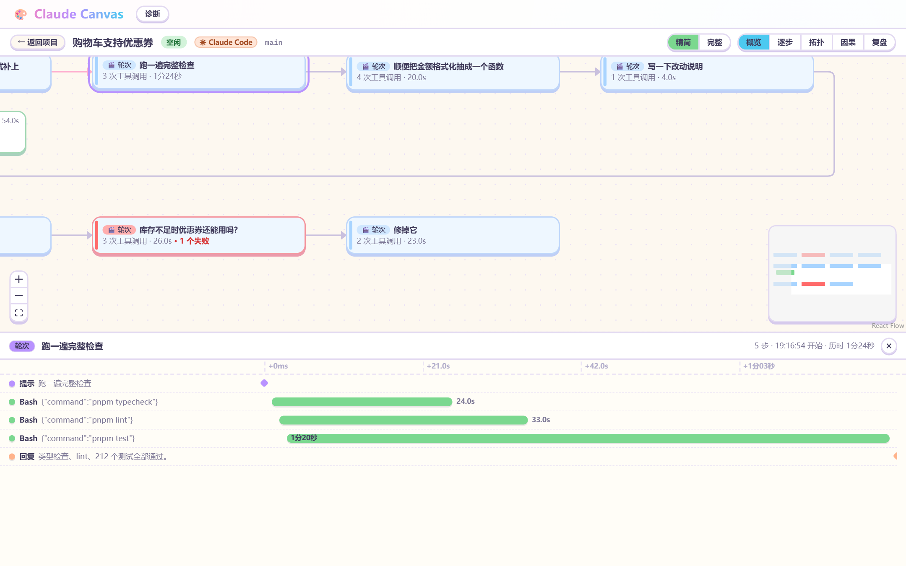
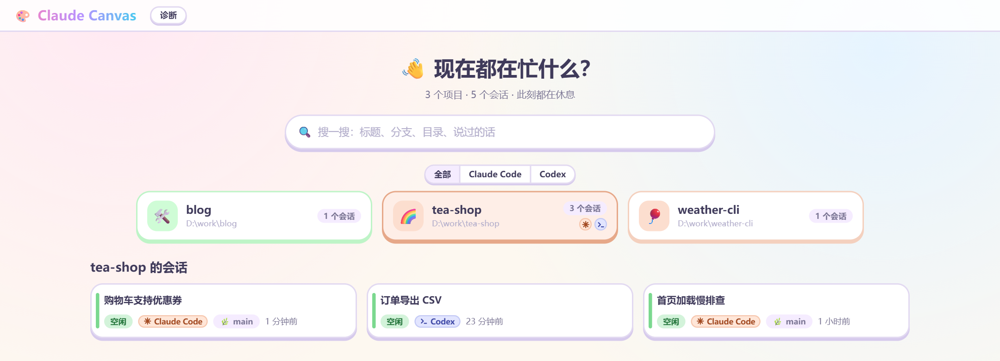
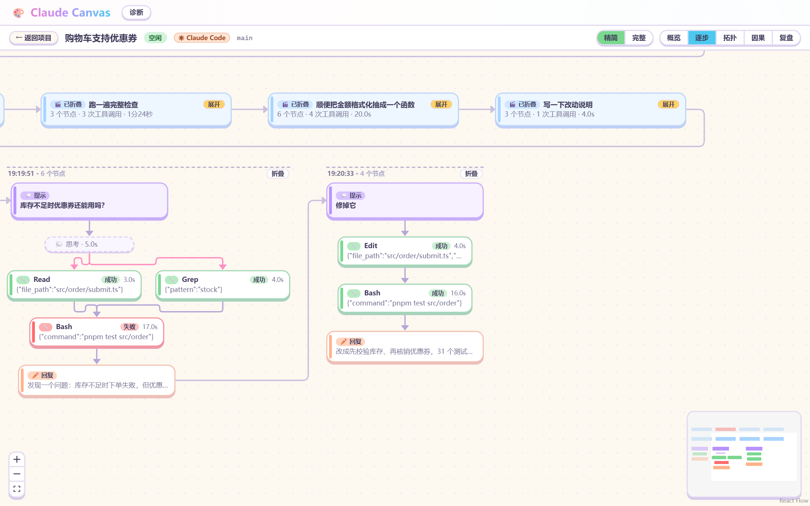
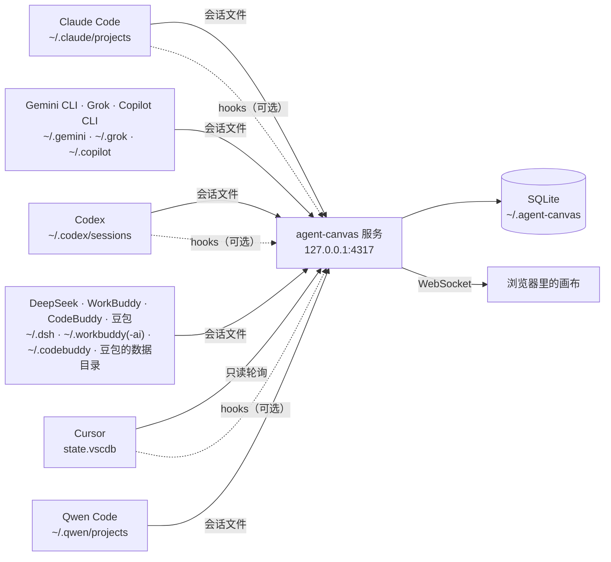

<h1 align="center">🎨 Agent Canvas</h1>

<p align="center">
  <b>把编码智能体正在做的事，画成一张看得懂的画布。</b>
</p>

<p align="center">
  Agent Canvas 是一个跑在你本机的小服务。<br/>
  它读取 Claude Code、OpenAI Codex、Cursor 的会话记录（Gemini CLI、Grok、GitHub Copilot CLI、DeepSeek Harness、WorkBuddy、CodeBuddy Code、豆包工作、Qwen Code 也能读；其中 DeepSeek Harness 和 WorkBuddy 各用一个真实会话核对过，其余尚未经真实数据核对），在浏览器里实时画出每个会话的来龙去脉：<br/>
  问了什么、调了哪些工具、派了哪些子代理、哪一步慢、哪一步失败。
</p>

<p align="center">
  <a href="https://www.npmjs.com/package/@qtxsnwwb/agent-canvas"></a>
  <a href="./LICENSE"></a>
  
  
  
  
  
  
  
  
  
  
</p>

<p align="center">
  <a href="#-快速开始">快速开始</a> ·
  <a href="#-六个视角">六个视角</a> ·
  <a href="#-支持情况">支持情况</a> ·
  <a href="./docs/manual.md">使用手册</a>
</p>

<p align="center">
  
</p>
<p align="center">
  <em>概览：每个轮次一张卡片，排成网格；点开一个轮次，下方的瀑布图列出它的每一步和耗时</em>
</p>

## ✨ 为什么用它

### 👀 一眼看清会话在干什么
终端里的输出滚过去就没了。画布把一个会话拆成轮次，每个轮次一张卡片：用了几次工具、花了多久、有没有失败，不用翻记录。

### ⏱️ 知道时间花在哪
选中任意一个轮次或子代理，瀑布图按时间轴列出每一步。并行的调用并排显示，慢的那一步一眼就能看出来。

### 🤖 子代理不再是黑盒
主线派出的子代理挂在对应的轮次下面，可以展开看它内部的每一步；后台运行的子代理会一直跟到它真正结束。

### 🧩 多种工具，一个页面
Claude Code、Codex、Cursor 的会话放在一起，Gemini CLI、Grok、Copilot CLI、DeepSeek Harness、WorkBuddy、CodeBuddy Code、豆包工作、Qwen Code 的也能放进来（这八个里只有 DeepSeek Harness 和 WorkBuddy 各用一个真实会话核对过，其余还没用真实数据核对过，见手册的 [Gemini CLI、Grok、Copilot CLI](./docs/manual.md#gemini-cligrokcopilot-cli)、[DeepSeek Harness、WorkBuddy、CodeBuddy Code、豆包工作](./docs/manual.md#deepseek-harnessworkbuddycodebuddy-code豆包工作) 和 [Qwen Code](./docs/manual.md#qwen-code)）。同一个工作目录下的会话归到同一个项目，每个会话带来源标记，首页可以按来源筛选。

### ⚡ 接近实时
只靠会话文件就能工作，延迟几秒。装上 hooks 之后状态变化在 1 秒内到达，还能看到“正在等你确认权限”。

### 📁 按文件看
一个会话读过、改过哪些文件，每个文件是在哪几步被动的，点一下就定位到画布上的那一步。反过来也行：某个文件被哪些会话、哪个工具动过。

### 🔎 搜到具体那一步
记得某句回复、某条命令、某段报错，却忘了在哪个会话里？首页的检索能搜到会话里面的内容（提示、回复、命令、工具输出），中文、英文、路径都行，点结果直接跳到那一步。

### 📊 跨会话的统计
时间花在哪、哪类工具调用最慢、哪些命令最常失败、token 用了多少，以及各工具在同一个项目上的差别，一页看全。可按时间范围、来源、项目筛选。每个页面的顶栏都有“今天”用了多少 token（新输入 + 输出，不含缓存读取），超过你设的提醒线时可以弹通知。

### ⚖️ 两个会话并排比
同一个任务换个做法、换个 agent 再做一遍，把两个会话放在一起比：总用时、工具调用、失败、token，按类别（跑命令、读文件、改写文件……）和按工具名的调用次数，每一轮，碰过哪些文件。

### 🔖 书签
值得回头找的会话和某一步，收藏起来，可以写一句备注；顶栏的“书签”列出全部，点一下回到那一步。

### 🚨 揪出不对劲的地方
代理卡在循环里、一连串调用失败、同一个文件改个没完、某一轮消耗离谱——这些情况会被自动标出来，首页和画布上一眼可见，点一下定位到那一步。正在运行的会话原地打转时还能弹通知，让你及时打断。

### 📤 导出给别人看，密钥自动遮住
把一个会话导出成一个双击就能打开的 HTML（只读画布，不联网）或一份 Markdown，发给同事、贴进工单。导出前先告诉你找到了几处密钥、token、密码，导出的文件里它们都被替换掉。投屏、截图时还可以打开顶栏的“遮蔽”开关，页面上同样不显示这些值。遮蔽是尽力而为，分享前请自己再看一遍。

### 🔔 需要你的时候叫你
会话在等你确认权限、一轮跑完、出错中断、卡住很久时，在桌面上弹一条系统通知，点一下就打开那个会话。不用一直盯着页面。默认关着，在页面的“通知”里打开。
顶栏的“[待处理](./docs/manual.md#待处理)”把此刻在等你的会话（等你批准、出错中断、卡住了、跑完了）列在一页，实时更新，看过的点“知道了”移走；不开通知也能用。

### 🖥️ 后台常驻
`agent-canvas service install` 之后，登录就在后台启动，不开终端窗口，意外退出会被拉起来；`service status`、`service stop`、`service uninstall` 查看、停止、卸载。Windows、macOS、Linux 都支持。

### 🔒 数据不出本机
只监听 `127.0.0.1`，不联网、不上传。对会话文件只读，数据存在本地的 SQLite 里。

## 📸 界面一览

<p align="center">
  
</p>
<p align="center">
  <em>首页：按项目列出会话，可检索、可按来源筛选</em>
</p>

<p align="center">
  
</p>
<p align="center">
  <em>逐步视角：提示、思考、工具调用、回复一个个画出来，并行的调用左右排开</em>
</p>

> 截图里的项目和对话都是虚构的演示数据。

## 🚀 快速开始

需要 **Node ≥ 22**。一条命令，不用克隆、不用构建：

```bash
npx @qtxsnwwb/agent-canvas
```

终端打印出地址后，在浏览器打开：

```
agent-canvas listening on http://127.0.0.1:4317
```

就这些。第一次启动会在后台导入已有的会话，历史多的话要等一会儿，期间页面已经可以用。

<details>
<summary><b>长期使用：全局安装</b></summary>

```bash
npm install -g @qtxsnwwb/agent-canvas
agent-canvas                 # 启动
agent-canvas --port 4400     # 换端口
agent-canvas --version
```

按 `Ctrl+C` 停止。同一个数据目录同时只能运行一个服务。想装 Codex 或 Cursor 的 hooks 的话，需要用这种方式安装（见下）。

想让它登录后自动在后台运行：`agent-canvas service install`（见[使用手册 · 后台常驻](./docs/manual.md#后台常驻)）。

升级和卸载：

```bash
npm install -g @qtxsnwwb/agent-canvas@latest   # 升级；路径不变，hooks 不用重装（装了后台常驻的话先 service stop，见手册）
```

卸载按这个顺序：

```bash
agent-canvas service uninstall                 # 1. 装过后台常驻的话：停掉服务、取消登录自动启动
agent-canvas hooks uninstall                   # 2. 装过 hooks 的话（Codex / Cursor 的加 --codex / --cursor）
npm uninstall -g @qtxsnwwb/agent-canvas        # 3. 卸载程序
```

卸载不会删除数据目录 `~/.agent-canvas`，不再需要时手动删掉。

</details>

<details>
<summary><b>装不上或跑不起来时</b></summary>

- **Windows PowerShell 提示“禁止运行脚本”**：这是 PowerShell 的执行策略不允许运行 `npm.ps1` / `npx.ps1` / `agent-canvas.ps1`。在命令后面加上 `.cmd` 即可，不用改系统设置：`npx.cmd @qtxsnwwb/agent-canvas`、`npm.cmd install -g @qtxsnwwb/agent-canvas`、`agent-canvas.cmd`。也可以改用“命令提示符”（cmd）。
- **用了 npm 镜像，提示找不到包或版本**：镜像同步新版本可能有延迟，加上 `--registry=https://registry.npmjs.org/` 直接从官方源安装。
- **安装时出现 `prebuild-install` 已不再维护的警告**：来自数据库依赖 better-sqlite3，不影响使用。
- **Node 版本低于 22**：先升级 Node（`node --version` 查看）。

</details>

### 🔌 可选：装上 hooks，状态更实时

不装也能用。装了之后状态变化更快，并且能显示“等待权限确认”。

```bash
# Claude Code
agent-canvas hooks install

# Codex（装完需要在 Codex 的 设置 → Hooks 里确认信任）
agent-canvas hooks install --codex

# Cursor（保存后自动生效）
agent-canvas hooks install --cursor
```

没有全局安装时，把 `agent-canvas` 换成 `npx @qtxsnwwb/agent-canvas`。Codex 和 Cursor 的 hooks 里要写入程序的绝对路径，而 `npx` 的缓存位置不固定，所以这两种 hooks 只能在全局安装之后装；Claude Code 的不受影响。

安装前会先列出要改的文件和内容并询问确认，改之前自动备份；`hooks uninstall`（加 `--codex` / `--cursor` 对应另外两个工具）可以原样移除。Cursor 的 hooks 只装观察类事件，不会拦住 Cursor 的任何操作，所以 Cursor 会话没有“等待权限确认”。细节见[使用手册 · Hooks](./docs/manual.md#hooks可选)。

## 🖼️ 六个视角

| 视角 | 看什么 | 适合 |
|------|--------|------|
| **概览**（默认） | 每个轮次一张卡片，下面挂它派出的子代理；选中后下方出瀑布图 | 快速了解一个会话做了什么 |
| **逐步** | 提示、思考、工具、回复全部画出来 | 看某一轮的具体过程 |
| **拓扑** | 隐藏思考和回复，只留提示、工具调用和子代理 | 看主线和子代理的分工 |
| **因果** | 选中一个节点，高亮它上游的一整条链 | 追问“这一步是怎么来的” |
| **复盘** | 拖动时间轴重放整个会话，带耗时和 token | 事后回顾、找瓶颈 |
| **时间线** | 主线和每个子代理各一行，画在同一条时间轴上；每个子代理有“主线等它多久”和“它自己干了多久” | 看时间花在哪个子代理上 |

画布按网格排版：轮次从左到右排，排满换行；一轮里步骤太多时折成并排的几列。会话再长，也不会变成一条拉不到头的竖线。

## 🧩 支持情况

| 能力 | Claude Code | Codex | Cursor |
|------|:-----------:|:-----:|:------:|
| 数据来源 | 会话文件 | 会话文件 | 本地数据库（只读） |
| 轮次、工具调用、回复 | ✅ | ✅ | ✅ |
| 并行调用的分叉与汇合 | ✅ | ✅ | ✅ |
| 子代理（含嵌套） | ✅ | ✅ | ✅ |
| 每一步的耗时与成败 | ✅ | ✅ | ✅ |
| 思考内容 | ⚠️ 多数只有时长 | ⚠️ 只有摘要，多数为空 | ⚠️ 只有 Cursor 存下来的部分 |
| token 用量 | ✅ | ✅ | ❌ Cursor 不记录 |
| hooks：实时状态 | ✅ | ⚠️ 已实现，未用真实数据验证 | ⚠️ 已实现，未用真实数据验证 |
| hooks：等待权限确认 | ✅ | ⚠️ 同上 | ❌ 不做（见手册） |
| 已归档的会话 | — | ❌ 不导入 | ❌ 不导入 |

另外三个来源只读会话文件，**未经真实数据核对**（手边没有这些工具产生的数据，读法依据公开源码和文档）：

| 能力 | Gemini CLI | Grok | Copilot CLI |
|------|:----------:|:----:|:-----------:|
| 数据来源 | 会话文件 `~/.gemini/tmp` | 会话文件 `~/.grok/sessions` | 会话文件 `~/.copilot/session-state` |
| 轮次、工具调用、回复、子代理 | ⚠️ 未核对 | ⚠️ 未核对 | ⚠️ 未核对 |
| token 用量 | ⚠️ 每次回复 | ⚠️ 每轮，对应关系是推测的 | ⚠️ 只有整个会话的总量 |
| “消耗异常高”检测 | ✅ | ⚠️ 只看有用量记录的会话 | ❌ 不参与 |
| hooks、实时状态、等待权限确认 | ❌ 不做 | ❌ 不做 | ❌ 不做 |

这三个工具的会话目录如果在服务启动之后才出现（通常是装好后第一次使用时），要重启服务才会读取；下面的 DeepSeek Harness、WorkBuddy、CodeBuddy Code、豆包工作、Qwen Code 也一样。装了后台常驻的话用 `agent-canvas service restart` 重启。显示不对时先看诊断页里该来源的“未识别的记录”。细节和各自的限制见[使用手册 · Gemini CLI、Grok、Copilot CLI](./docs/manual.md#gemini-cligrokcopilot-cli)。

还有四个国内的工具，同样只读会话文件，**大部分未经真实数据核对**（读法依据开源代码、安装包里的类型定义和第三方读取工具，依据写在 [`docs/formats/`](./docs/formats/) 里；DeepSeek Harness 在 2026-11-18、WorkBuddy 在 2026-11-27 各用一个真实会话核对过，范围见手册）：

| 能力 | DeepSeek Harness | WorkBuddy | CodeBuddy Code | 豆包工作 |
|------|:----------------:|:---------:|:--------------:|:--------:|
| 数据来源 | 会话文件 `~/.dsh/sessions`（只读第 4 版） | 会话文件 `~/.workbuddy`、`~/.workbuddy-ai`（国际版桌面应用核对过） | 会话文件 `~/.codebuddy` | 客户端数据目录里的会话文件（Windows、macOS） |
| 轮次、工具调用、回复、子代理 | ⚠️ 轮次、工具调用、回复核对过（含以出错结束的一轮）；子代理未核对 | ⚠️ 轮次、工具调用、回复核对过；子代理未核对；回退后只显示当前分支 | ⚠️ 未核对，回退后只显示当前分支 | ⚠️ 未核对 |
| 思考、模型、工作目录 | ⚠️ 思考、工作目录核对过；模型未核对 | ⚠️ 工作目录核对过（桌面应用每次对话一个新目录，各成一个项目）；思考、模型未核对 | ⚠️ 未核对 | ❌ 文件里没有；全部会话归入项目“豆包工作” |
| token 用量 | ✅ 每次回复，核对过 | ✅ 每次模型请求，核对过 | ⚠️ 换算是推测的 | ❌ 文件里没有 |
| “消耗异常高”检测 | ✅ | ✅ | ✅ | ❌ 不参与 |
| hooks、实时状态、等待权限确认 | ❌ 不做 | ❌ 不做 | ❌ 不做 | ❌ 不做 |

DeepSeek Harness 需要 Node 22.15 或更高（更早的 Node 上这个来源不启动，诊断页会写明）。豆包的普通聊天和在云电脑上执行的任务本机不留记录，读不到。千问办公、TRAE CLI、CodeBuddy 的 IDE 插件不支持。细节和限制见[使用手册 · DeepSeek Harness、WorkBuddy、CodeBuddy Code、豆包工作](./docs/manual.md#deepseek-harnessworkbuddycodebuddy-code豆包工作)。

还有 Qwen Code（阿里的命令行编码代理），同样只读会话文件、**未经真实数据核对**（读法依据它 `v0.27.4` 的开源代码，见 [`docs/formats/qwen-code.md`](./docs/formats/qwen-code.md)）：

| 能力 | Qwen Code |
|------|:---------:|
| 数据来源 | 会话文件 `~/.qwen/projects`（或 `$QWEN_RUNTIME_DIR`、`$QWEN_HOME` 下的 `projects`） |
| 轮次、工具调用、回复、思考、子代理 | ⚠️ 未核对，回退后只显示当前分支 |
| token 用量 | ⚠️ 每次回复；`/branch` 复制出来的会话跨会话相加时重复 |
| “消耗异常高”检测 | ✅ |
| 跑完了、出错中断 | ⚠️ 只在 Qwen Code 写了一轮的结果记录时（较早的版本不写，会话一直是运行中） |
| hooks、实时状态、等待权限确认 | ❌ 不做 |

托管会话和 0.4.0 以前的旧文件不读。细节和限制见[使用手册 · Qwen Code](./docs/manual.md#qwen-code)。

| 平台 | 状态 |
|------|------|
| Windows | ✅ 经过测试 |
| macOS / Linux | ⚠️ 应当可用，未系统测试 |

## 🏗️ 它是怎么工作的



服务监视 Claude Code、Codex（以及 Gemini CLI、Grok、Copilot CLI、DeepSeek Harness、WorkBuddy、CodeBuddy Code、豆包工作、Qwen Code）的会话文件，每隔几秒只读地查一次 Cursor 的本地数据库，把各来源的记录归一成同一种图（节点和边），存进本地数据库，再通过 WebSocket 推给页面。原始记录也一并保存，升级后可以据此重新推导，不需要重新导入。

## ⚙️ 配置

都是可选的环境变量：

| 变量 | 默认值 | 含义 |
|------|--------|------|
| `AGENT_CANVAS_PROJECTS_DIR` | `~/.claude/projects` | Claude Code 会话文件的目录 |
| `AGENT_CANVAS_CODEX_DIR` | `~/.codex/sessions` | Codex 会话文件的目录；设为空字符串表示不读取 |
| `AGENT_CANVAS_CURSOR_DB` | Cursor 的 `state.vscdb`（按平台，见手册） | Cursor 的本地数据库，只读打开；设为空字符串表示不读取 |
| `AGENT_CANVAS_GEMINI_DIR` | `~/.gemini`（或 `$GEMINI_CLI_HOME/.gemini`） | Gemini CLI 的目录；设为空字符串表示不读取 |
| `AGENT_CANVAS_GROK_DIR` | `~/.grok`（或 `$GROK_HOME`） | Grok 的目录；设为空字符串表示不读取 |
| `AGENT_CANVAS_COPILOT_DIR` | `~/.copilot`（或 `$COPILOT_HOME`） | Copilot CLI 的目录；设为空字符串表示不读取 |
| `AGENT_CANVAS_DSH_DIR` | `~/.dsh`（或 `$DSH_HOME`） | DeepSeek Harness 的主目录；设为空字符串表示不读取 |
| `AGENT_CANVAS_WORKBUDDY_DIR` | `~/.workbuddy` 和 `~/.workbuddy-ai`（或 `$WORKBUDDY_CONFIG_DIR`） | WorkBuddy 的目录（只能设一个）；设为空字符串表示不读取 |
| `AGENT_CANVAS_CODEBUDDY_DIR` | `~/.codebuddy`（或 `$CODEBUDDY_CONFIG_DIR`） | CodeBuddy Code 的目录；设为空字符串表示不读取 |
| `AGENT_CANVAS_DOUBAO_DIR` | 豆包工作和豆包应用的数据目录（按平台，见手册） | 豆包工作的“User Data”这一层目录（只能设一个）；设为空字符串表示不读取 |
| `AGENT_CANVAS_QWEN_DIR` | `~/.qwen`（或 `$QWEN_RUNTIME_DIR`，再或 `$QWEN_HOME`） | Qwen Code 的运行时目录（读其中的 `projects`）；设为空字符串表示不读取 |
| `AGENT_CANVAS_DATA_DIR` | `~/.agent-canvas` | 数据目录（数据库 `data.db`） |

完整列表见[使用手册 · 数据与环境变量](./docs/manual.md#数据与环境变量)。

## 🔒 安全与隐私

- 只监听 `127.0.0.1`，不对局域网开放；来自非本机页面的请求会被拒绝。
- 没有账号、没有遥测、不联网。
- 对会话文件只读，从不往 Gemini CLI、Grok、Copilot CLI、DeepSeek Harness、WorkBuddy、CodeBuddy Code、豆包、Qwen Code 的目录写任何东西；Cursor 的数据库只读打开，只做按主键的短查询，从不写入。只有你主动运行 `hooks install` 时，才会修改 Claude Code、Codex 或 Cursor 的配置文件，并且先备份。
- 数据库里是你的对话和工具输出的明文，请像对待对话记录本身一样对待数据目录。

## 📚 文档

- [使用手册](./docs/manual.md)：首页检索、各视角的细节、hooks、诊断页、重建、已知限制
- [按文件看](./docs/manual.md#按文件看)：会话里的文件面板、文件页、各来源能看到什么
- [统计](./docs/manual.md#统计)：每个数字的口径、token 的三种分类
- [异常](./docs/manual.md#异常)：四类异常的判定规则、在哪里看、会误报的情况
- [导出与分享](./docs/manual.md#导出与分享)：HTML 和 Markdown 两种格式、范围和内容选项、大小上限
- [遮蔽敏感信息](./docs/manual.md#遮蔽敏感信息)：遮什么、已知会漏什么、页面上的遮蔽开关防的是什么
- [后台常驻](./docs/manual.md#后台常驻)：登录后自动启动、停止、升级、日志、各系统怎么登记
- [时间线](./docs/manual.md#时间线)：子代理的等待和各自用时怎么算
- [今天的用量](./docs/manual.md#今天的用量)：顶栏“今天”的口径、提醒线
- [对比两个会话](./docs/manual.md#对比两个会话)：怎么打开、每一块的口径、加粗表示什么
- [书签](./docs/manual.md#书签)：收藏会话和步骤、备注、找不到的书签
- [通知](./docs/manual.md#通知)：七种提醒的判定、设置、各来源的差别
- [待处理](./docs/manual.md#待处理)：此刻在等你的会话怎么判定、“知道了”之后
- [Gemini CLI、Grok、Copilot CLI](./docs/manual.md#gemini-cligrokcopilot-cli)：读哪里、显示什么、各自的限制（未经真实数据核对）
- [DeepSeek Harness、WorkBuddy、CodeBuddy Code、豆包工作](./docs/manual.md#deepseek-harnessworkbuddycodebuddy-code豆包工作)：读哪里、显示什么、各自的限制、不支持的工具、核对过什么（DeepSeek Harness、WorkBuddy 各核对过一个真实会话，其余未核对）
- [Qwen Code](./docs/manual.md#qwen-code)：读哪里（含改过输出目录时怎么指过去）、显示什么、限制（未经真实数据核对）
- [格式说明](./docs/formats/)：后加的这些工具的会话文件格式和每条结论的出处
- [诊断页](./docs/manual.md#诊断页)：页面右上角的“诊断”，看导入进度、hook 是否收到、未识别的记录
- [已知限制](./docs/manual.md#已知限制)

## 🛠️ 开发

```bash
git clone https://github.com/qtxsnwwb/agent-canvas.git
cd agent-canvas
pnpm install                            # 没装 pnpm 时用 npx --yes pnpm@10 代替 pnpm
pnpm build
pnpm start                              # 从源码启动

pnpm test                               # 单元测试（vitest）
pnpm typecheck
pnpm --filter @agent-canvas/web dev    # 网页开发服务器，需先启动服务
pnpm release                            # 在 release/ 里生成要发布到 npm 的包
```

项目是一个 pnpm workspace：`packages/server`（Fastify + better-sqlite3）、`packages/web`（React + React Flow）、`packages/shared`（共用的图模型）。发布到 npm 的是把三者合成的一个包 `@qtxsnwwb/agent-canvas`。

每个 PR 和 `main` 上的每次推送都会在 Linux 和 Windows 上自动运行类型检查、构建、全套测试和发布包检查（`.github/workflows/ci.yml`）。

发版：把四个 `package.json`（根目录和 `packages/` 下的三个）的 `version` 一起改成新版本号并合并到 `main`，然后推送同名标签（版本 `0.3.0` 对应标签 `v0.3.0`）。发布到 npm 的包用根目录的版本号，但从源码运行时 `agent-canvas --version` 显示的是 `packages/server/package.json` 的，所以四个要一起改。`.github/workflows/release.yml` 会核对标签与版本号、重跑全部检查、发布到 npm，并在 GitHub 上建一个 Release。发布用的是 npm 的可信发布（OIDC），仓库里不保存任何 npm 令牌。

可信发布要在 npmjs.com 上这个包的 Settings → Trusted Publisher 里配置一次：选 GitHub Actions，填仓库 `qtxsnwwb/agent-canvas` 和工作流文件名 `release.yml`，并在 Allowed actions 里勾选 **Allow npm publish**。新建的可信发布者默认只允许暂存发布（`npm stage publish`），不勾这一项，工作流会在发布那一步报 `OIDC permission denied for this action`。

## 📄 许可证

[MIT](./LICENSE)

Claude、Claude Code、Codex、OpenAI、Cursor、Gemini、Grok、GitHub Copilot、DeepSeek、WorkBuddy、CodeBuddy、豆包、Qwen 等名称和标志是各自所有者的商标。界面里用它们只是为了标明会话来自哪个工具（Gemini CLI、Grok、Copilot CLI、DeepSeek、WorkBuddy、CodeBuddy、豆包、Qwen Code 用的是本项目自绘的字母标记，不是它们的标志）；本项目与这些公司没有隶属或合作关系，这些标志也不在 MIT 许可的范围内。
